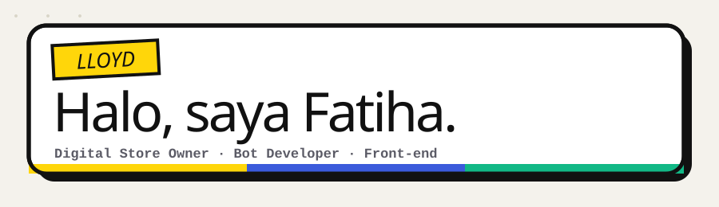
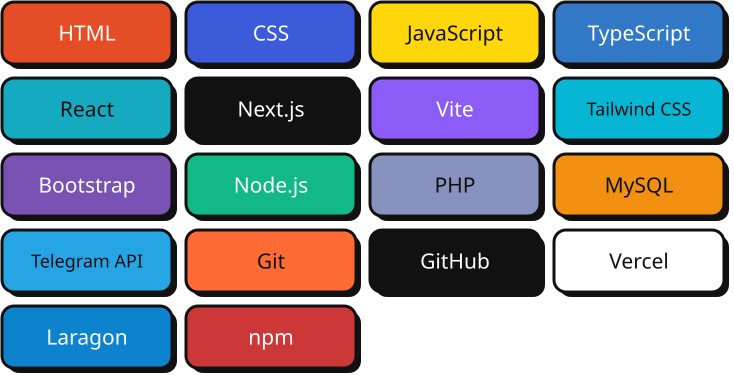

---

## Tentang Saya

<table>
<tr><td width="64"></td><td>Membangun <b>Lloyd Market</b>, toko langganan aplikasi premium</td></tr>
<tr><td></td><td>Mengembangkan bot Telegram auto-order dengan <b>Node.js</b></td></tr>
<tr><td></td><td>Membuat web tools dan situs front-end dengan <b>React + Vite</b></td></tr>
<tr><td></td><td>Sedang belajar front-end dan otomasi lebih dalam</td></tr>
<tr><td></td><td>Tanya saya soal bot, web tools, dan produk digital</td></tr>
</table>

## Tech Stack

## GitHub Stats

## Contribution Snake

<picture>
  <source media="(prefers-color-scheme: dark)" srcset="https://raw.githubusercontent.com/lloyddevile/lloyddevile/output/github-snake-dark.svg" />
  <source media="(prefers-color-scheme: light)" srcset="https://raw.githubusercontent.com/lloyddevile/lloyddevile/output/github-snake.svg" />
  
</picture>

## Hubungi Saya

